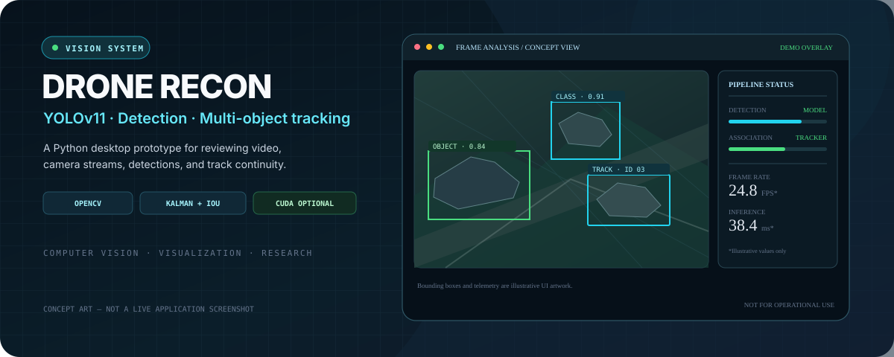

# DRONE RECON
### YOLOv11 Computer Vision & Multi-Object Tracking

Concept artwork for the README — not a screenshot or live telemetry from the application.

  
  
  
  
  

**A Python desktop prototype for video analysis, object detection, visual tracking, and an animated computer-vision HUD.**

[Repository](https://github.com/computerengineer1/DRONE-yolov11) · [Quick Start](#-quick-start) · [Architecture](#-architecture) · [Configuration](#%EF%B8%8F-configuration) · [Limitations & responsible use](#-important-limitations--responsible-use)

---

## Overview

**DRONE RECON** combines an Ultralytics YOLO detector, OpenCV video capture, a Kalman-filter multi-object tracker, and a CustomTkinter desktop interface. It can process a local image or video, a webcam, or a compatible network stream and draw detection boxes, IDs, confidence values, simulated HUD graphics, and runtime metrics over the frames.

The repository is a **computer-vision visualization prototype**, not a complete autonomous drone system. It does not implement flight control, navigation, GPS integration, sensor fusion, or a validated real-world object-identification system.

### At a glance

| Area | Current implementation |
|---|---|
| Application | Python desktop GUI built with CustomTkinter |
| Default detector weights | **yolo11s.pt**, configured in config.py |
| Vision pipeline | Ultralytics YOLO inference on OpenCV BGR frames |
| Tracking | Per-object OpenCV Kalman filters, IoU association, Hungarian assignment, and EMA box smoothing |
| Sources | Local images, local videos, webcam index 0, and user-supplied stream URLs accepted by OpenCV |
| HUD | Animated scanning effects, bounding-box brackets, labels, compass/horizon-style graphics, and performance counters |
| Acceleration | PyTorch CUDA/FP16 when a compatible CUDA-enabled PyTorch installation is available; CPU fallback otherwise |
| Optional export | A TensorRT engine export action is included; it requires a compatible NVIDIA/TensorRT environment |
| Storage / backend | No application server or database is present in the repository |

## ✨ Features

- **YOLO object detection:** loads the configured Ultralytics model lazily when processing starts, with configurable confidence and IoU thresholds.
- **Multi-object tracking:** associates detections across frames using IoU costs and the Hungarian assignment algorithm, then updates per-object Kalman filters.
- **Bounding-box smoothing:** an exponential moving average reduces visual jitter.
- **Skipped-frame prediction:** the app can run detector inference on every Nth frame while predicting tracked boxes on intervening frames.
- **Visual analysis HUD:** draws labels, corner brackets, a focus-object information panel, scan effects, a decorative compass strip, a horizon indicator, and post-processing effects.
- **Runtime metrics:** displays estimated display FPS, the most recently measured inference time, frame resolution, device selection, and the current number of tracked objects.
- **Local media workflow:** open supported image/video files. Videos can be paused and scrubbed with the timeline controls; video playback loops at end of file in the current processing loop.
- **Live source workflow:** open the default webcam or enter a compatible stream URL supported by OpenCV, such as an RTSP stream.
- **TensorRT export action:** attempts to export the currently loaded .pt model to a TensorRT engine when the required software and GPU stack are available.
- **Dark desktop interface:** a fixed sidebar, media canvas, timeline controls, and status bar.

## 🧱 Architecture

~~~mermaid
flowchart TD
    A["User selects image, video, webcam, or stream"] --> B["OpenCV VideoCapture"]
    B --> C["Processing worker thread"]
    C --> D{"Run inference this frame?"}
    D -->|Yes| E["YOLO detector"]
    E --> F["Detection boxes, classes, confidence scores"]
    D -->|No| G["Tracker prediction"]
    F --> H["Kalman + IoU association Hungarian assignment"]
    H --> I["Track state + EMA smoothing"]
    G --> I
    I --> J["HUD overlay + visual effects"]
    J --> K["Bounded frame queue"]
    K --> L["CustomTkinter display polling"]
    L --> M["Video view, metrics, timeline, status"]
~~~

### Repository layout

~~~text
DRONE-yolov11/
├── main.py                 # Desktop application entry point
├── config.py               # Model, device, detection, tracking, and HUD defaults
├── requirements.txt        # Python dependencies
├── engine/
│   ├── detector.py         # YOLO inference and optional TensorRT export
│   ├── tracker.py          # Kalman filters, association, and EMA smoothing
│   └── utils.py            # Detection/track data structures and helpers
├── hud/
│   ├── overlay.py          # Composes the full HUD
│   ├── targeting.py        # Bounding brackets and object information panels
│   ├── compass.py          # Animated decorative compass strip
│   ├── horizon.py          # Horizon-style visual indicator
│   ├── scanner.py          # Animated scan lines and grid effects
│   └── effects.py          # Vignette, scanlines, and chromatic effects
├── ui/
│   ├── app.py              # CustomTkinter UI and video processing lifecycle
│   └── theme.py            # Palette, typography, and button styles
└── docs/
    └── drone-recon-hero.svg # README concept artwork
~~~

## 🚀 Quick Start

### Requirements

- Windows, macOS, or Linux with a working Python installation.
- **Python 3.10 or newer is a reasonable starting point**; select a version supported by the PyTorch and Ultralytics versions installed on your machine.
- pip and a virtual environment.
- A webcam or media file for a first run.
- Optional NVIDIA GPU with a compatible CUDA-enabled PyTorch installation for GPU inference. CPU execution is configured as the fallback.

### 1. Clone the repository

~~~bash
git clone https://github.com/computerengineer1/DRONE-yolov11.git
cd DRONE-yolov11
~~~

### 2. Create and activate a virtual environment

**Windows PowerShell**

~~~powershell
py -m venv .venv
.\.venv\Scripts\Activate.ps1
python -m pip install --upgrade pip
~~~

If PowerShell blocks activation because of local execution-policy settings, use the Python executable directly from the virtual environment or follow your organization's approved setup instead of changing system-wide policy.

**macOS / Linux**

~~~bash
python3 -m venv .venv
source .venv/bin/activate
python -m pip install --upgrade pip
~~~

### 3. Install dependencies

~~~bash
pip install -r requirements.txt
~~~

The requirements include Ultralytics, OpenCV, PyTorch, torchvision, CustomTkinter, Pillow, NumPy, and SciPy.

**GPU note:** installing a generic PyTorch package does not guarantee CUDA acceleration. For NVIDIA inference, install a PyTorch build that matches the CUDA support available on your system; use the official [PyTorch installation selector](https://pytorch.org/get-started/locally/) and verify that **torch.cuda.is_available()** returns **True**.

### 4. Launch the application

~~~bash
python main.py
~~~

The model is lazy-loaded when you start media processing. If the configured **yolo11s.pt** weights are not already available locally, Ultralytics may download them during the first model load. That requires internet access and can take time.

### 5. First run

1. Click **UPLOAD MEDIA** to choose a supported local image or video, or use **LIVE STREAM** to open a webcam/network source.
2. Wait for the model to load and for the status bar to indicate that the source is active.
3. Adjust the confidence threshold to see how the number of displayed detections changes.
4. Use the video pause and timeline controls when working with a seekable video.
5. Click **STOP** before switching sources or closing the application.

For a first smoke check, use a short, ordinary sample clip that you are authorized to analyze. Avoid testing with footage of people or sensitive locations without an appropriate legal basis and privacy safeguards.

## 🎥 Inputs and controls

| Input | Behavior |
|---|---|
| Upload Media | Opens the local file picker for common image and video formats |
| Live Stream | Uses the URL field, or webcam index 0 when the field is empty |
| RTSP / URL | Passes the supplied source string to OpenCV VideoCapture; compatibility depends on the OpenCV build and the stream |
| Confidence threshold | Adjusts the detector threshold while the detector is loaded |
| Play / Pause | Pauses or resumes a seekable video source |
| Timeline | Seeks within a seekable video and resets tracker state after seeking |
| Stop | Stops processing, releases the capture, resets tracking, and returns to the idle view |
| Export TensorRT | Attempts to export the loaded .pt model as TensorRT FP16; export is optional and environment-dependent |

Supported file extensions declared by the GUI include common formats such as MP4, AVI, MOV, MKV, WMV, FLV, WEBM, JPG, JPEG, PNG, BMP, TIFF, and WEBP. Actual decoding depends on codecs available to OpenCV.

## ⚙️ Configuration

The main defaults live in **config.py**.

| Setting | Default | Meaning |
|---|---:|---|
| **MODEL_PATH** | yolo11s.pt | Ultralytics model/weights path |
| **DEVICE** | Auto | cuda if PyTorch reports CUDA availability, otherwise cpu |
| **USE_HALF** | CUDA-dependent | Enables FP16 inference when the detected device is CUDA |
| **CONFIDENCE_THRESHOLD** | 0.20 | Minimum detection confidence |
| **IOU_THRESHOLD** | 0.40 | Detector non-maximum-suppression IoU threshold |
| **INPUT_SIZE** | (1280, 720) | Declared processing target; inspect the actual call path before assuming this tuple forces model inference size |
| **UPSCALE_TARGET** | 1280 | Upscales frames whose largest dimension is below this size before detection |
| **FRAME_SKIP** | 2 | Runs detection every second frame by default; other frames use tracker prediction |
| **EMA_ALPHA** | 0.35 | Smoothing coefficient for displayed bounding boxes |
| **LOCK_FRAMES_THRESHOLD** | 18 | Number of matched frames used for the visual LOCKED state |
| **MAX_TRACKER_AGE** | 30 | Removes a tracker after too many frames without a match |
| **IOU_MATCH_THRESHOLD** | 0.20 | Minimum IoU used to associate a detection with a predicted track |
| **VIRTUAL_FOCAL_LENGTH** | 800 | Approximate focal-length constant used by the rough pixel-height distance formula |

### Model choice and acceleration

The detector loads **MODEL_PATH** from **config.py**. The repository does not include a trained custom drone-detection model or the .pt model weights themselves. The configured filename **yolo11s.pt** refers to a general Ultralytics model name; do **not** assume it was trained specifically to identify drones or military equipment.

The TensorRT button exports the currently loaded .pt model. It does not by itself guarantee that the newly exported engine is used in the current session. To load a different compatible model, update **MODEL_PATH** to that model's local path and verify the detector's backend before relying on it.

## 🧠 Detection and tracking: what the code actually does

The default detector uses an Ultralytics model on each selected inference frame. Detection results contain a bounding box, model class ID, and confidence score. The tracker predicts object box state and associates new detections using Intersection over Union (IoU) cost and SciPy's Hungarian assignment, then smooths coordinates for visualization.

The current configuration sets **TARGET_CLASSES = None**, so detector output is not restricted to a specific list of COCO class IDs. The subsequent display names are supplied by a custom remapping in **config.py**, not by a specialized vehicle/aircraft recognition model.

### Class-label remapping is only a heuristic

Examples from the current configuration:

| General pretrained class IDs | Display label in this project | Important limitation |
|---|---|---|
| Person | PERSONNEL | This is a generic class label, not identity or affiliation recognition. |
| Car, bus, truck | MERKAVA MBT | This mapping does **not** establish that a tank is present; ordinary road vehicles can receive this label. |
| Bicycle, motorcycle, train | LIGHT VEHICLE | These are different object categories and may be misrepresented by this shared label. |
| Airplane | AIRCRAFT | Depends on the pretrained detector's general-class prediction and image conditions. |
| Boat | NAVAL ASSET | Does not identify a specific vessel type or capability. |
| Selected accessory/object classes | EQUIPMENT | A broad display label, not equipment identification. |
| Remaining COCO classes | OBJECT | A generic catch-all label. |

These mappings are presentation heuristics in code; they are not a validated domain taxonomy. Do not use the resulting labels to identify real military assets, classify people, make operational decisions, or guide any physical system.

## 📏 Distance and HUD telemetry limitations

### Distance is an uncalibrated estimate

The helper in **engine/utils.py** estimates distance from an object's bounding-box height using a fixed reference height and a virtual focal-length constant. In simplified form, it behaves like:

~~~text
estimated distance ≈ reference object height × virtual focal length / bounding-box pixel height
~~~

Real range estimation requires reliable class dimensions, camera calibration, lens and zoom information, viewing geometry, and known measurement conditions. Those are not supplied by this implementation. The displayed distance can be substantially wrong and should be treated as a **rough illustrative value only**, not a measurement.

### Some HUD elements are simulated

- The compass helper generates animated heading drift when no heading value is supplied. The current HUD compositor calls it without a physical heading source.
- Horizon attitude graphics are rendered by the HUD code; the repository does not implement an IMU/flight-controller telemetry input pipeline.
- The TRACKING, ACQUIRING, and LOCKED labels reflect local track age/matched-frame thresholds. They are software visualization states, not a physical sensor lock or proof that an object has been identified correctly.
- The animated scan, vignette, scanlines, chromatic shift, and REC-style UI decoration are visual effects. They should not be interpreted as evidence of sensor capability or actual recording state.

## 🧩 Module guide

| File | Responsibility |
|---|---|
| **main.py** | Sets the dark CustomTkinter appearance and starts the desktop application |
| **config.py** | Defines the model path, confidence/IoU thresholds, label mapping, tracking thresholds, distance assumptions, and HUD colors |
| **engine/detector.py** | Loads the Ultralytics model, warms it up, runs inference, rescales boxes after image upscaling, and offers an optional TensorRT export |
| **engine/tracker.py** | Maintains object tracks with OpenCV Kalman filters, Hungarian assignment, IoU matching, age-out logic, and EMA box smoothing |
| **engine/utils.py** | Detection and track data classes, IoU calculation, and rough distance formula |
| **hud/overlay.py** | Orchestrates all overlay components and renders FPS/inference telemetry |
| **hud/targeting.py** | Draws tracking brackets and per-object data panels |
| **hud/compass.py** / **hud/horizon.py** | Decorative compass and horizon-style visualizations |
| **hud/scanner.py** / **hud/effects.py** | Scan bands, grid, vignette, scanlines, and color-channel effects |
| **ui/app.py** | File/stream selection, model loading, processing thread, frame queue, timeline, and GUI lifecycle |
| **ui/theme.py** | Desktop colors, typography, and button styling |

## 🛠️ Troubleshooting

| Problem | Checks |
|---|---|
| ModuleNotFoundError | Activate the intended virtual environment and rerun pip install -r requirements.txt. |
| Model file is missing or first launch takes a long time | Confirm the configured model path. If Ultralytics must obtain the weights, make sure internet access is available for the initial download. |
| Application uses CPU unexpectedly | Check that PyTorch is installed with compatible CUDA support and that torch.cuda.is_available() returns True. |
| CUDA or FP16 errors | Try a compatible PyTorch/CUDA/driver combination; CPU inference can be slower but is the fallback configured by the project. |
| TensorRT export fails | TensorRT export has additional environment requirements beyond requirements.txt, including compatible NVIDIA software and a supported GPU. Read the Ultralytics export documentation before enabling it. |
| Webcam opens but no image appears | Check OS camera permissions, ensure another app is not holding the camera, and try a supported camera index. |
| RTSP/network stream fails | Verify the stream URL, credentials, network reachability, stream codec, and OpenCV/FFmpeg support. Keep credentials private. |
| A video does not decode | Try a common format such as MP4/H.264 with a compatible OpenCV build. |
| Boxes flicker or disappear | Adjust the confidence threshold for visualization and check whether motion blur, resolution, occlusion, or the pretrained classes explain the detections. Lowering a threshold can also add false positives. |
| Distance or class label appears implausible | This is an expected limitation of the rough distance formula and heuristic class remapping; neither is calibrated for reliable real-world identification. |

## 🔐 Privacy and responsible use

- Process only media and streams that you own or have permission to analyze. Respect applicable privacy, consent, and recording laws.
- Treat detections as uncertain model predictions. A confidence value is not a guarantee of correctness.
- Do not infer a person's identity, intent, affiliation, or threat level from these generic object detections.
- Do not rely on the class mapping, simulated HUD instruments, frame-based lock labels, or pixel-height range estimate for navigation, targeting, safety-critical decisions, or any use that could cause harm.
- Network stream URLs may contain credentials. Do not share screenshots, logs, or screen recordings that expose them.
- Use a compatible general-purpose dataset and consent-respecting test footage for experimentation. This repository contains no model-training pipeline, validation benchmark, or evidence of field performance.

## 🧪 Tests and validation

No automated test suite, test configuration, or CI workflow was present in the repository tree at the time this README was created. The commands below are therefore basic local checks, not a claim that the project has passed a test suite.

~~~powershell
python -m compileall main.py config.py engine hud ui
python -c "import torch; print('PyTorch:', torch.__version__); print('CUDA available:', torch.cuda.is_available())"
python main.py
~~~

The final command is a manual GUI smoke test. Load a short sample file and verify that source opening, model loading, frame display, stop/close, and cleanup behave as expected. Validate any model, device, or tracking changes with representative labelled data before drawing conclusions about accuracy.

## 📦 Dependencies

The current **requirements.txt** declares:

- **ultralytics** — YOLO models and prediction/export interface.
- **opencv-python** — media capture, frame operations, Kalman filter primitives, and overlay drawing.
- **torch** and **torchvision** — neural-network inference.
- **customtkinter** — desktop GUI.
- **Pillow** — image conversion for GUI display.
- **numpy** — numerical arrays and frame operations.
- **scipy** — Hungarian assignment via scipy.optimize.linear_sum_assignment.

Versions are expressed as minimums rather than a fully reproducible lockfile. For repeatable deployments, test and pin a compatible dependency set for your Python version and hardware.

## Roadmap ideas

- Add a non-military, dataset-backed evaluation harness with labelled test clips and precision/recall metrics.
- Replace heuristic class relabeling with transparent, model-native class names and optional user-defined display aliases.
- Calibrate distance only when verified camera parameters and appropriate measurements are available, and label estimates with uncertainty.
- Connect the compass/horizon UI to actual, explicitly sourced telemetry only if a separate lawful sensor integration is implemented.
- Add unit tests for box association, tracker lifecycle, source cleanup, and frame-queue behavior.
- Add a portable packaging workflow after a tested dependency and model-weight distribution strategy is chosen.

## License

No root-level LICENSE file was present when this README was created. Unless the repository owner adds a license, do not assume the code is licensed for redistribution or reuse beyond the permissions granted by applicable platform terms.

---

**Computer vision is a tool for observation—not a substitute for validated evidence.**

DRONE RECON · Python · YOLO · OpenCV

